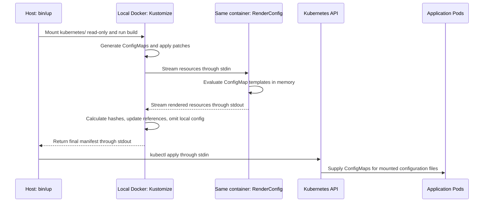

# ZooKage

ZooKage helps you run big data animals in a sandbox environment.

## Supported components

You can launch the following components on Kubernetes on Docker Desktop with a single command.

* Apache Hadoop(HDFS, YARN, MapReduce)
* Apache HBase
* Apache Hive
* Apache Ozone
* Apache Spark
* Apache Tez
* Apache ZooKeeper
* Trino

## How to use

See the [document](https://zookage.org/) and [Quick Start](https://zookage.org/docs/quick-start).

## Configuration templates

`./bin/up` runs Kustomize in a local `zookage-util` Docker container. A custom
Transformer evaluates ConfigMap templates after patches have been applied and
before Kustomize calculates content hashes and updates references. The completed
manifest is then applied to Kubernetes. Evaluated configuration files are never
saved on the host.

The renderer is implemented in [`docker/util/config-renderer`](docker/util/config-renderer)
and installed as the `RenderConfig` exec plugin in `zookage-util`. Build the
updated image with `./docker/build-util.sh`, using `docker/sample-build.env` as
the reference for `docker/build.env`, including `GO_IMAGE`. `bin/up` requires
Docker and host `kubectl`; it does not require a local Go installation.
If `docker/build.env` already exists, add `GO_IMAGE` from the sample before
rebuilding.
The build container defaults to `zookage/zookage-util:experimental`. Override it
with `ZOOKAGE_UTIL_IMAGE=<image> ./bin/up`. This variable selects the image used
for rendering independently of the workload image tags in the Kustomization.

The renderer uses Go templates with Helm's `.Values` convention. Templates use
the standard Go template functions and control flow; Helm-specific objects and
functions such as `.Release`, `include`, and `tpl` are not provided.

Non-secret defaults are defined in the configuration templates themselves.
The base [`config-values.yaml`](kubernetes/base/common/config/config-values.yaml)
has an empty `data` map. Enable the usual patches in `kubernetes/kustomization.yaml`
to supply overrides. For example, the Trino authentication patch contains:

```yaml
apiVersion: v1
kind: ConfigMap
metadata:
  name: config-values
data:
  trino_iceberg_oauth2_enabled: "true"
```

Templates can then conditionally emit settings:

```gotemplate
{{- if eq (index .Values "trino_iceberg_oauth2_enabled") "true" }}
iceberg.rest-catalog.security=OAUTH2
{{- end }}
```

Use the standard Go template functions `index` and `or` to provide a default:

```gotemplate
<value>{{ or (index .Values "hive_execution_mode") "container" | html }}</value>
```

All values stay strings, including `"true"` and `"false"`. Use `eq` to compare
flags with `"true"`; a non-empty string such as `"false"` is truthy in a bare `if`.
`index` returns an empty string for an omitted key; `or` chooses the fallback
for missing or empty values and preserves strings such as `"false"` and `"0"`.
A direct `.Values.key` lookup still fails if that key is missing.
Use `| html` for interpolated XML text. Keep
application expressions such as `${hadoop.tmp.dir}` and secret references such
as `${ENV:AWS_SECRET_ACCESS_KEY}` in the templates; rendering does not expand them.

Templates retain their original filenames, such as `core-site.xml`, and enter
their usual ConfigMaps through `configMapGenerator`. The Transformer checks
every ConfigMap's `data` and evaluates strings containing `{{`. Other strings,
including static files such as `hadoop/hadoop-metrics2.properties`, stay unchanged.
Secrets and `binaryData` are not evaluated. No separate template ConfigMap or
output mapping is needed.

The root Kustomization registers [`render-config.yaml`](kubernetes/render-config.yaml)
under `transformers`; the checked-in test profiles do the same. Keep this
registration at the root so the Transformer sees all feature patches. The
`config-values` ConfigMap is marked `config.kubernetes.io/local-config: "true"`:
it supplies `.Values` during the build and is omitted from the final manifest.
Existing patches can change these values and Kubernetes resources together;
for example, the HDFS HA patch enables automatic failover and changes the
JournalNode replica count to three. ConfigMap hashes and workload references
reflect the final, rendered contents.



The build container runs without network access, with a read-only filesystem
and a temporary in-memory `/tmp`. Kustomize stores its plugin invocation config
there; rendered resources travel through process memory and stdin/stdout. The
host shell holds the completed manifest in memory until `kubectl apply`.
No renderer Job, ServiceAccount, or Kubernetes API access is needed during the
build. Kubernetes stores the applied ConfigMaps, and kubelet exposes their data
as files in the application's mounted volumes.

Rendering failures stop `bin/up` before it changes the cluster.
ConfigMap content changes update the hashes and Pod template
references, triggering the workloads' normal rollout behavior. This repository
stores cluster data in `emptyDir` volumes, so recreating its Pods also discards
that data. Deploy with `./bin/up`: it enables the required
`--enable-alpha-plugins` flag and uses the image containing the plugin. A plain
`kubectl apply -k` does not enable the plugin.

`./bin/down` deletes the `zookage` namespace without depending on configuration
rendering.
